# Glass TV

**Make your Android TV or Google TV fast and ad-free again: strip out the bloat and ads, free up memory,
and come home to just your apps, with a new place to visit behind them every week.**

<p align="center">
  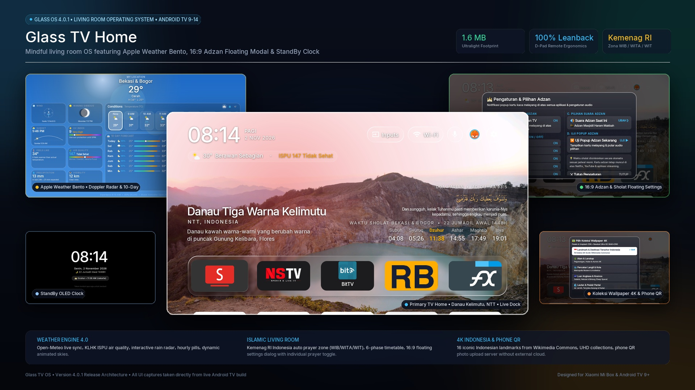
</p>

<p align="center">
  <a href="https://github.com/nstv-official/nstv-glass-tv-home-ota/raw/main/release/glass-tv-home.apk">
    
  </a>
  &nbsp;
  <a href="https://github.com/nstv-official/nstv-glass-tv-home-ota/raw/main/release/glass-tv-installer.apk">
    
  </a>
</p>

> 🚨 **PERINGATAN PENTING: JANGAN SIDELOAD APK SECARA MENTAH!**
> Banyak pengguna mengunduh file APK langsung melalui flashdisk USB atau aplikasi *Downloader* di TV. **Ini adalah kesalahan besar pada Android TV & Google TV!**
> - Firmware Android TV akan memperlakukan Glass TV sebagai aplikasi biasa, bukan peluncur utama sistem.
> - Saat Anda menekan tombol **HOME** pada remote TV, sistem tetap akan kembali ke layar utama bawaan pabrikan yang sarat iklan dan bloatware.
> - Server unggah gambar mungkin terhambat jika port diblokir, dan resolusi tampilan tidak disetel dengan benar.
> 
> 👉 **GUNAKAN 2 METODE PALING PRAKTIS & MUDAH DI BAWAH:**
> 1. 🤖 **Metode 1 (Sangat Direkomendasikan — Prompt AI 1 Baris)**: Salin prompt di [AI_INSTALL_PROMPT.md](AI_INSTALL_PROMPT.md) ke asisten AI (Google Antigravity, Claude Code, Cursor). AI akan mengaudit versi TV, resolusi 1080p vs 4K, DPI, dan mengunci tombol Home secara otomatis!
> 2. 📱 **Metode 2 (Tanpa PC — Aplikasi Android di Ponsel)**: Pasang [**`release/glass-tv-installer.apk`**](https://github.com/nstv-official/nstv-glass-tv-home-ota/raw/main/release/glass-tv-installer.apk) di ponsel Anda. Hubungkan ke Wi-Fi yang sama, lalu tekan *Pasang Langsung ke TV* untuk mengunci tombol Home dalam 1 klik tanpa komputer!

> 📦 **Official APK Downloads**:
> - 📺 **Android TV / Google TV Launcher**: [**`release/glass-tv-home.apk`**](https://github.com/nstv-official/nstv-glass-tv-home-ota/raw/main/release/glass-tv-home.apk) (**v4.0.3** • ~1.5 MB)
> - 📱 **Phone / Tablet Companion Installer**: [**`release/glass-tv-installer.apk`**](https://github.com/nstv-official/nstv-glass-tv-home-ota/raw/main/release/glass-tv-installer.apk) (**v1.0.0** • ~6.6 MB) — Kunci tombol Home TV langsung dari ponsel tanpa PC!
>
> 🤖 **AI Prompt & Audit Guide**:
> - ⚡ **[AI_INSTALL_PROMPT.md](AI_INSTALL_PROMPT.md)**: Instruksi lengkap AI untuk audit TV (1080p vs 4K, DPI, IP LAN, stock launcher), debloat, dan kunci tombol Home.
> - 📋 **[PROMPT.md](PROMPT.md)**: Format prompt cepat 1-baris untuk semua coding assistants.
>
> 📖 **User Guides / Panduan Pengguna**:
> - 🇬🇧 **English User Guide**: Complete beginner walkthrough, 1-line AI setup, remote navigation, phone setup & FAQ in [USER_GUIDE.md](USER_GUIDE.md).
> - 🇮🇩 **Panduan Bahasa Indonesia**: Panduan lengkap langkah demi langkah untuk pengguna baru di [PANDUAN_PENGGUNA.md](PANDUAN_PENGGUNA.md).

Glass TV debloats any Android TV or Google TV over Wi-Fi, with no root and nothing that can't be undone, then
swaps the ad-filled home screen for a light one in frosted glass, with a new set of places behind your apps
every week.

<p align="center">
  
  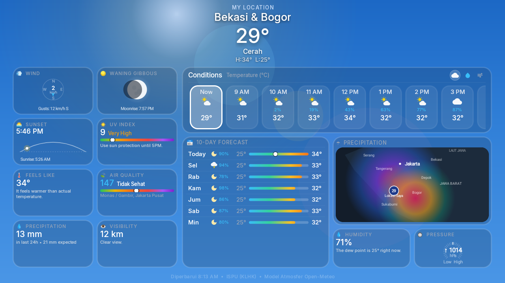
  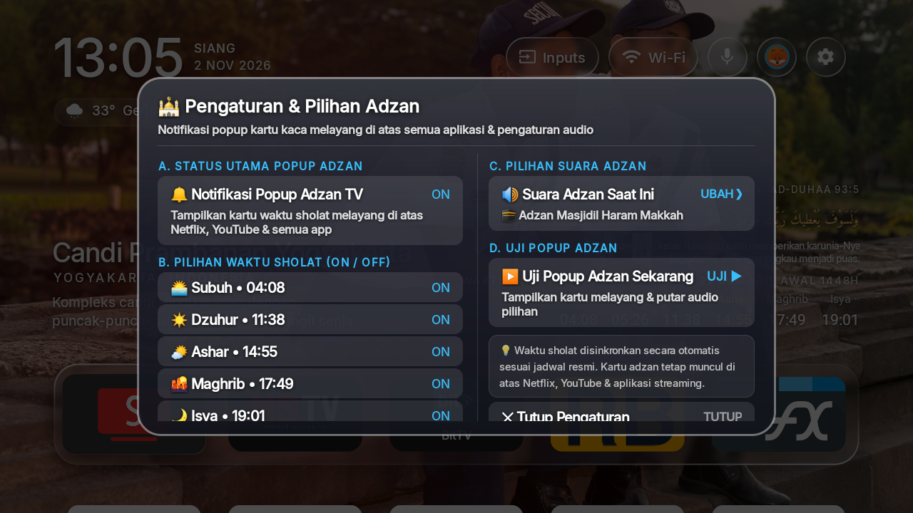
  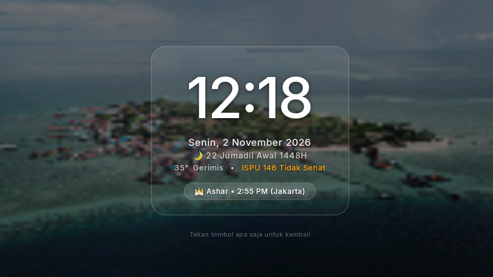
  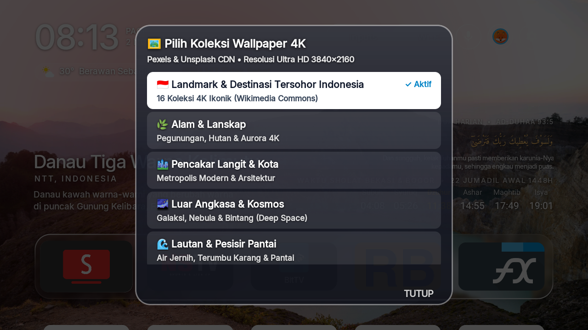
</p>

## What's New in Version 4.0.3

- **The final donation QRIS.** The QR code shown under *Dukung Pengembang* — in the OTA dialog on the TV and in
  the phone installer — is the registered one now, issued to **DIGITAL PRODUCK**. It is also square-ish instead of
  a tall strip, so it stops stretching the card it sits in: both layouts size the picture to its real ratio
  (933 × 1068) and the QR fills its frame with no empty band above or below. The lighter file also trims the APK.

## What's New in Version 4.0.2

- **StandBy Screensaver, Now a Real Setting.** The screensaver is no longer a plain black clock on an empty
  screen. A new **Mode StandBy** tab in Settings (`⚙️`) drives everything on it, and the choices are stored on the
  TV, so they survive reboots and updates:
  - **4 clock styles**: *Digital Terpusat* (big centred numerals), *Analog Minimalis* (a hand-drawn dial with a
    ring showing how much of the day has passed), *Editorial Kiri* (light left-aligned typography) and
    *Bento Widget* (frosted cards for clock, weather, Hijri date and prayer).
  - **3 backgrounds**: today's wallpaper softened into frosted glass (the new default), an *aurora* glow whose
    colour follows the hour, or pure black OLED for panels that want the lowest power draw.
  - **Elements you can switch on or off**: the glass card, the date, the Hijri date, the next-prayer capsule,
    the weather line and the "press any key" hint.
  - **Format, size and dimming**: 12 or 24 hours (or follow the TV), four digit sizes from 80sp to 170sp, and
    four dim levels, plus the red night wind-down mode on automatic, always, or never.
  - **Timing**: how long the TV must be idle before the screensaver appears, how much longer before it truly
    sleeps, and how often the clock drifts to protect an OLED panel.
  - Both paths — the overlay inside Home and the system screensaver (`DreamService`) — are now drawn by the same
    code, so a choice made in Settings looks identical either way.
- **Language Cleanup.** Remaining Malay wording in the interface (such as `SEMASA`) is now Indonesian, and the
  Indonesian landmark labels read *Terkenal* instead of *Tersohor*.

## What's New in Version 4.0

- **Inter Font Typography Universally Applied**: The entire system UI, Leanback clock, settings, Islamic prayer timetable, weather bento cards, and app drawers are now rendered using the world-class **Inter** geometric sans-serif typeface (`@font/inter`) for ultra-crisp legibility from couch viewing distance.
- **Top Bar Active User Avatar Switcher**: The top bar user button dynamically displays the currently active user's **animal avatar icon** (Fox, Panda, Tiger, Lion, Frog, Koala, Octopus) inside a circular accent status ring (Cyan for adult, Amber for child mode). Users immediately see which family ID is currently active.
- **Multi-User Profile & Child Mode Engine**: Create up to 10 independent family profiles with custom names and animal avatars. Features dedicated **Child Mode** with PIN protection, individual app locking, and hidden app management.
- **Self-Adapting 1080p & 4K UHD Hardware Engine**: Automatically audits display modes (`Display.getMode()`), supporting 4K UHD 60Hz panels with smooth 1080p 60fps UI framebuffers. Safely downsamples 48MP/8K phone camera wallpapers using `inSampleSize` and `RGB_565` to prevent Out-Of-Memory crashes on 1GB/2GB TVs.
- **Fail-Safe Local HTTP Wallpaper Server**: Automatically binds across ports `8080 -> 8888 -> 8081 -> dynamic port 0` so that local Wi-Fi QR wallpaper upload from mobile never fails due to port blocking.
- **Default Launcher Card in Settings (TV & Sistem)**: Built-in system card detecting default launcher status and providing direct TV settings navigation and ADB locking commands.

## What you get

- **Recent Apps & RAM Manager (Double-Press Home).** A native tvOS-style 3D CoverFlow app switcher and memory optimizer:
  - **Double-Press Home Button**: Double-pressing the remote's Home button from anywhere on the TV brings up the frosted glass Recent Apps deck.
  - **Double-Press Home to Close All**: Double-pressing Home again while inside the Recent Apps screen triggers `Close All` immediately—killing all background tasks and clearing memory in one step!
  - **Genuine Force-Stop Automation**: Integrates Accessibility automated force-stop to cleanly and completely terminate even stubborn foreground media apps (e.g. video players, streaming apps) that resist standard background process termination.
  - **Live RAM Gauge**: Real-time memory consumption display (`RAM 1.8 GB used of 2.3 GB`) with a sleek recessed progress bar.
  - **Individual App Dismissal**: Press `▲ (Up)` on any app card to slide it away, force-stop its process, and immediately reclaim RAM.
  - **Close All Button**: Click the circular `Close All` button (`🗑️`) at the end of the carousel to kill all running apps at once.
- **Weather & Air Quality Engine.** A full-screen Leanback weather hub (`WeatherActivity`) accessible directly from the under-clock pill:
  - Current condition, apparent temperature, humidity, wind velocity, UV index, sunrise and sunset times.
  - Air Quality Index (AQI / ISPU) from Indonesia's KLHK (Kementerian Lingkungan Hidup) ISPU network with a multi-color spectrum gauge, station comparisons, PM2.5 / PM10 readings, and health advisories.
  - Next 12 Hours hourly forecast pills and 7-day daily forecast cards with precipitation probabilities.
- **Islamic Prayer Timetable & Daily Ayat.** A mindful cultural shelf:
  - 6-phase timetable (Subuh, Syuruq, Dzuhur, Ashar, Maghrib, Isya) with emerald highlighting for the active prayer window.
  - Daily Quranic Ayat of the Day with Arabic calligraphy and translations.
- **StandBy Ambient Mode & Smart Energy Lifecycle.**
  - **Idle, then screensaver**: after the pause you choose (10 minutes by default) an ambient StandBy screensaver
    appears — clock, Islamic Hijri calendar, next prayer capsule and weather, over a frosted card and a softened
    wallpaper — with a late-night red monochrome wind-down mode.
  - **Every part is configurable** from *Settings (`⚙️`) → Mode StandBy*: style, background, elements, clock format,
    digit size, dimming and timing.
  - **Later, the TV sleeps**: after the extra pause you choose (2 hours by default) the display turns off into deep
    standby via Android's Accessibility Service (`GLOBAL_ACTION_LOCK_SCREEN`).
- **Frosted Glass Settings Dropdown & 4K Wallpaper Categories.**
  - **Floating Glass Dropdown**: Clicking the top Settings icon (`⚙️`) opens a native Apple tvOS-style glass menu under the button.
  - **Dynamic 4K Wallpaper Switcher**: Switch themes on the fly between *Natural*, *🇮🇩 Landmark & Destinasi Terkenal Indonesia*, *Pencakar Langit & Kota* (Jakarta, Manhattan, Chicago, Dubai, HK), *Luar Angkasa & Kosmos*, *Lautan & Pesisir Pantai*, or trigger *Next Wallpaper*.
  - **🇮🇩 Indonesian Landmark Collection**: 16 iconic Indonesian landmarks and destinations (Borobudur, Raja Ampat, Komodo, Kawah Ijen, and more) curated from Wikimedia Commons, rotated automatically or picked individually.
  - **Built-in Haze & Prayer Zone Selectors**: Select from dozens of KLHK (ISPU) air quality stations and official Kemenag RI prayer zones (WIB/WITA/WIT) without needing a computer or AI.
  - **All Settings Shortcut**: Access standard Android TV settings in one click (or by long-pressing Settings).
- **Phone QR Wallpaper Upload & Gallery Manager (Phone-to-TV).**
  - **Instant QR Code Wi-Fi Upload**: Scan the QR code on TV with any phone to open a frosted glass web uploader. Send personal high-res wallpapers straight to TV with zero third-party cloud apps.
  - **Full Mobile & TV Photo Manager**: Manage uploaded wallpapers directly on mobile or TV with remote D-pad. Lock a single picture as permanent wallpaper (`📌 Single Mode`), switch back to rotating slideshow (`🔄 Putar Semua`), or delete unwanted pictures (`🗑️`).
  - **Clean View for Custom Wallpapers**: Description/hero text shelf is automatically hidden (`View.GONE`) for custom wallpapers so personal photos remain 100% unobstructed.
- **Console Sound Effects & Mute Toggle (PS5, Nintendo Switch, Xbox).**
  - **3 Iconic Console Profiles**: Choose your favorite sound profile from the Settings menu (`⚙️`):
    - **PlayStation 5**: Futuristic soft swooshes and acoustic tactile clicks.
    - **Nintendo Switch**: Crisp mechanical snap and bright affirmative chime.
    - **Xbox Series X/S**: Resonant warm mid-bass navigation blips and two-tone modern rising chime.
  - **Mute / Silent Mode (`Off`)**: Toggle sound effects completely off for a whisper-quiet late-night browsing experience.
  - **Live Audition**: Plays instant sound previews upon selecting an option in the dialog.
  - **Persistent Memory**: Saved across reboots and app launches via TV shared preferences.
- **OTA In-App Auto Update & 1-Line AI Patching.**
  - **In-App OTA Check (`⚙️ Check for Updates`)**: Check, download, and install latest APK patches directly on the TV without a PC.
  - **Background Launch Check**: Glass TV silently checks for new releases on startup and prompts when a new update is ready to install.
  - **1-Line AI Update Prompt**: Paste `update patch latest glass tv ke tv rumah saya: https://github.com/nstv-official/nstv-glass-tv-home-ota` to any AI coding assistant to upgrade via ADB in 5 seconds without touching existing user data.

- **Keeps itself clean.** Every 15 days, while Home sits idle, the TV clears its app caches, where the Play
  Store leaves gigabytes of download leftovers that can make apps open to a blank screen. No computer needed,
  sign-ins and app data are never touched; the TV asks once to allow it.
- **Glass, like Apple's.** The dock's tray, the top-bar buttons and the menus show the picture behind them
  softened, with a shine along their edges. Android 10 has no live blur, so the picture is blurred once each
  time it changes and the glass draws its patch of it.
- **One selection that glides.** Between apps it is a pane of glass with the app's shadow under it; on the top
  bar and in the menus it is dark. It glides and changes shape from one to the next, never jumps.
- **Places to visit that renew themselves.** Once a week the TV takes the pictures Bing has shown on its home
  page over the past days — landmarks, landscapes, wildlife — deletes last week's and rotates through them,
  dimmed so the clock and tiles stay readable. The shelf above the dock names each one, its country and a few
  lines about it. Pictures with people in them are skipped: by the words in their caption, and by Android's
  own face detector on the TV. No key, no account, nothing to set up.
- **Every app tints the room.** The glow behind Home, and the glass with it, blends to the colour of whichever
  app is selected.
- **Arrange your apps from the remote.** Hold OK on an app for a glass menu with **Move** and **App info**.
  Move picks the app up: it wiggles, the arrows carry it (into or out of the dock too) and the other apps
  slide aside; OK puts it down. The order is kept, and apps installed later join at the end.
- **An Inputs menu in glass.** The selection glides out of the Inputs button into the list of HDMI and AV
  inputs, and Up from the top of the list glides it back.
- **Comes back as you left it.** Back from an app, the app you left is still selected; pressing Home on Home
  goes to the first app. When Android has closed Home to free memory, it comes back whole in one frame,
  with no black screen and no half-built dock.
- **A StandBy clock screensaver you can shape.** Four styles (digital, analog dial, editorial, bento cards),
  three backgrounds (softened wallpaper, aurora by hour, black OLED), a glass card, date, Hijri calendar and
  prayer capsule, four dim levels, and a slow drift to protect the panel — all of it in
  *Settings → Mode StandBy*.
- **Rows feather out under the top bar** instead of being cut off when you scroll, and the Wi-Fi / Ethernet
  button can be hidden (`show_network_pill`).
- **Rotating wallpapers of your own** instead, with `"places": false`: put pictures in a theme's `wallpapers/`
  folder and choose how often they change, down to every 5 seconds. Each picture is decoded in the background
  and cross-faded.

| | |
|---|---|
| 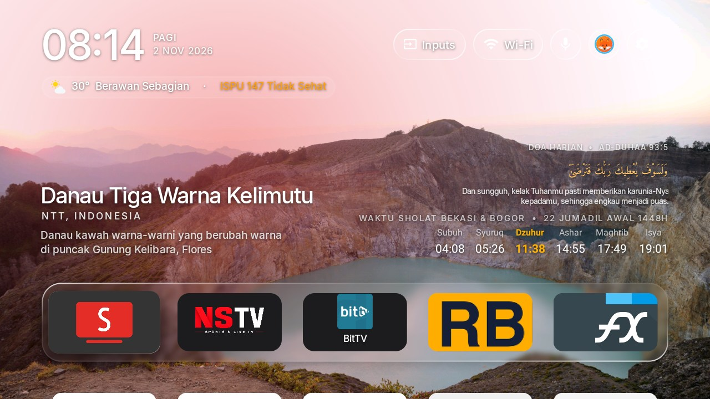 | 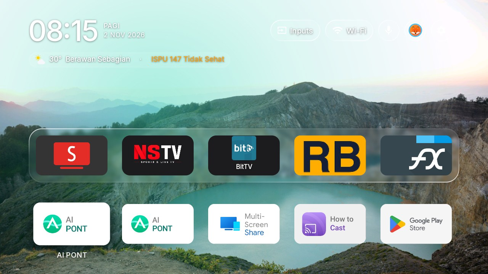 |
| *Home, with this week's place* | *Every app, feathering out under the top bar* |
| 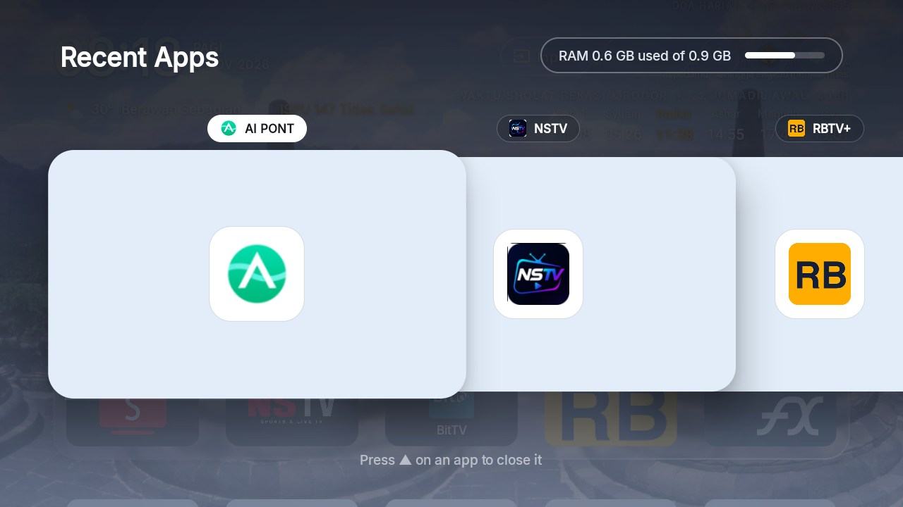 | 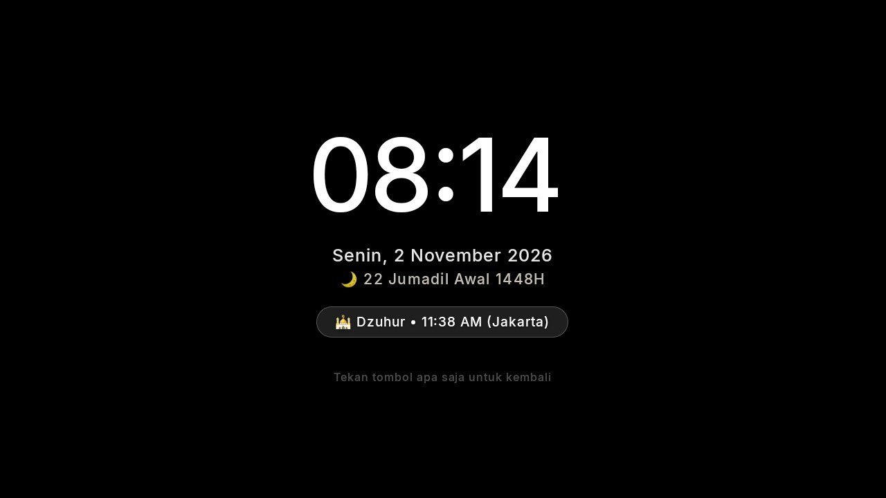 |
| *Recent Apps, in glass* | *The StandBy clock screensaver* |

### The StandBy screensaver, and the settings behind it

<p align="center">
  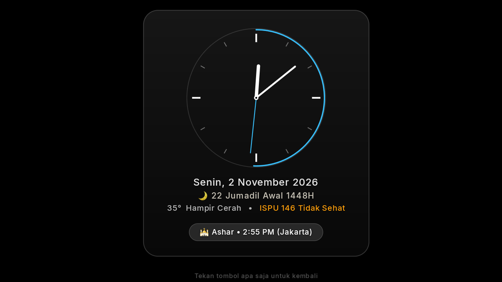
  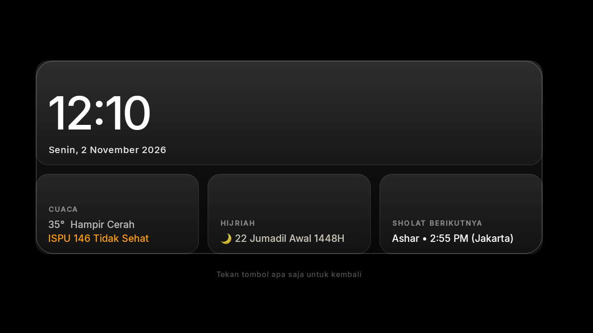
  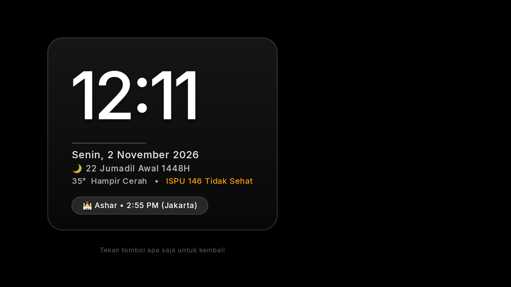
  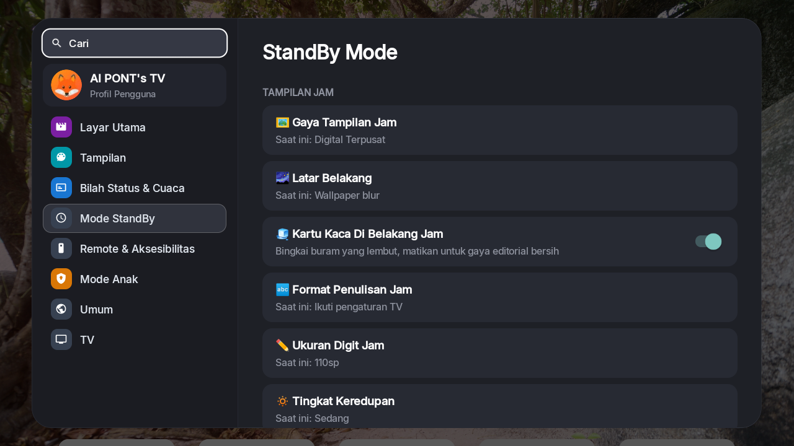
</p>

Still light: on a Xiaomi Mi TV with 1.8 GB of RAM the launcher uses about 80–100 MB and stays there over hours
of use, one wallpaper is in memory at a time, the week's places take about 2 MB of storage, and nothing runs
while you are inside an app.

## Setting it up (By Device Priority)

Choose the setup method based on your available devices:

### ⭐ Priority 1: Android Phone (Primary Focus — 1-Click Wireless & Zero PC)
Install directly from your Android phone or tablet without any computer or cables:
1. Turn ON **USB debugging** on TV (*Settings ⚙️ $\rightarrow$ About $\rightarrow$ click Build 7 times $\rightarrow$ Developer options*).
2. Install [**`release/glass-tv-installer.apk`**](https://github.com/nstv-official/nstv-glass-tv-home-ota/raw/main/release/glass-tv-installer.apk) on your Android phone.
3. Open the app, tap **`🔍 Pindai Android TV di Jaringan Wi-Fi`**, then tap **`🚀 Pasang Terus ke Android TV`** and press **Allow** on your TV screen!

### 💻 Priority 2: If No Android Phone — Use Laptop or PC (1-Line AI Setup)
Using a computer with an AI assistant (**Google Antigravity** [Free], **Claude Code** [Paid], **Cursor**)?
1. Enable **USB debugging** on your TV and connect to the same Wi-Fi.
2. Paste this single line to your AI assistant:
   ```text
   install ini ke tv rumah saya: https://github.com/nstv-official/nstv-glass-tv-home-ota
   ```
   *(Or in English: `install this on my home tv: https://github.com/nstv-official/nstv-glass-tv-home-ota`)*
3. The AI connects over Wi-Fi, creates a backup, removes sluggish ads & bloatware, and installs Glass TV Home automatically!

### 🍏 Priority 3: If No Android & No PC (iPhone Users) — Use iPhone & Muse.ai Assistance
Only have an iPhone/iPad?
1. Open Safari on iPhone and visit [**muse.ai**](https://muse.ai) for interactive AI assistance:
   > *"I have an iPhone and an Android TV [model]. Guide me step-by-step to install https://github.com/nstv-official/nstv-glass-tv-home-ota and give me a debloat list of useless apps to disable on my TV."*
2. Install the APK via TV's **Downloader** app or **LocalSend**, then disable manufacturer bloatware from TV Settings following Muse.ai's recommendations.

---

### 🔄 1-Line AI Update / Patch Prompt (For Existing Users)
Already have Glass TV installed and want to update to the latest release or patch? Paste this single line to your AI:
```text
update patch latest glass tv ke tv rumah saya: https://github.com/nstv-official/nstv-glass-tv-home-ota
```
*(Or in English: `update glass tv to the latest patch on my tv: https://github.com/nstv-official/nstv-glass-tv-home-ota`)*

> 🚨 **AI Update Rule / Aturan Khusus AI untuk Pembaruan**:
> When a user requests to update/patch Glass TV:
> 1. Connect to the TV over Wi-Fi (`adb connect <TV_IP>:5555`).
> 2. Install the latest prebuilt APK without wiping user data (`adb install -r release/glass-tv-home.apk`).
> 3. Relaunch the launcher (`adb shell am start -n com.gathin.tvhome/.MainActivity`).
> 4. All personal wallpapers, dock orders, and settings are 100% retained!

> 🚨 **AI Assistant Rule / Aturan Khusus AI**:
> When installing for a user, the AI **must ask the user for their location in Indonesia** (e.g. Jakarta, Bandung, Surabaya, Semarang, Yogyakarta, Medan, Makassar, Denpasar) to configure live KLHK ISPU haze data and Kemenag RI prayer times via:
> ```bash
> adb shell am broadcast -a com.gathin.tvhome.SET_LOCATION -p com.gathin.tvhome --es query "<LOCATION>"
> ```
> If installed manually without AI, users can change the station at any time directly on the TV using the remote control under **Settings (⚙️) $\rightarrow$ Location API Haze** or **Weather Dashboard $\rightarrow$ 📍 Ganti Stasiun / Change**.

> 📖 **Read the Beginner User Guides**:
> - 🇬🇧 **[USER_GUIDE.md](USER_GUIDE.md)**: Full English step-by-step guide (Developer Mode, AI prompts, manual station selector, iPhone & Android setups, FAQ).
> - 🇮🇩 **[PANDUAN_PENGGUNA.md](PANDUAN_PENGGUNA.md)**: Panduan penuh Bahasa Indonesia untuk pengguna baru (aktifkan Developer Mode, perintah AI, ganti stasiun manual via remote TV, ponsel & FAQ).

The full step-by-step guide for debloating and installing is in
[docs/CLEANYOURTV-README.md](docs/CLEANYOURTV-README.md), and [PROMPT.md](PROMPT.md) lets a coding assistant do
it for you. In short:

```bash
python3 -m venv tools/venv && tools/venv/bin/pip install -r tools/requirements.txt
export TV_HOST=192.168.1.50                                   # your TV's IP address
tools/disable.sh examples/<your tv>/debloat.txt               # debloat
launcher/build-and-install.sh                                 # build the launcher and make it Home
tools/theme.sh themes/<your theme>                            # push your settings and wallpapers
```

Glass TV clears the TV's caches by itself every 15 days ([how](docs/cache-clean.md)). To clean several TVs
from one computer instead, [`tools/cache-clean.sh`](docs/cache-clean.md) finds the TVs on your network and
clears their caches, leaving sign-ins and app data untouched.

## Which TVs work

Android TV and Google TV, Android 8 or newer, on the TV or on a box plugged into any TV.
[docs/DEVICES.md](docs/DEVICES.md) lists every tested model and how far each was tested: end to end with
Glass TV, with the original launcher, or debloat only, plus what is expected to work and what cannot.

### 🇮🇩 ISP Android TV Boxes (e.g. IndiHome / Biznet Home) Compatibility & Warranty
- **Can I use it on my ISP's TV box?** **Yes!** Any ISP TV box running certified Android TV / Google TV (Android 8 or newer) can install Glass TV Home via APK sideloading or wireless ADB. The official TV app from your provider remains fully operational so you never lose live TV channels or subscriptions.
- **Will it void the warranty?** **No, it will NOT void your warranty.** Glass TV Home is a standard user-space Android APK. It does **not** root the box, unlock the bootloader, or modify system firmware. You can uninstall it at any time from *Settings > Apps > Glass TV Home > Uninstall* or factory reset the box to return it 100% to its original factory state.

## LG and Samsung TVs

LG TVs run webOS and Samsung TVs run Tizen; neither can run Android apps, and neither lets any app replace its
home screen or the Home button. For the full Glass TV, plug in a Google TV or Android TV box (Chromecast with
Google TV, Xiaomi Mi Box, NVIDIA Shield): the TV becomes the screen and Glass TV is Home. On LG, a version you
open as an app is in preview in [webos/](webos/README.md).

## Places, or pictures of your own

Places are on from the start. To change how often the picture changes, or to use your own pictures and keep
the launcher offline, make a theme folder with a `config.json` like this and push it with `tools/theme.sh`:

```json
{
  "places": false,
  "wallpaper_seconds": 15,
  "show_network_pill": false
}
```

All keys are listed in [themes/README.md](themes/README.md). With `"places": false`, the launcher never goes
online.

## Credits and licence

- Built on [CleanYourTV](https://github.com/Gathin23/cleanyourtv) © 2026 Gathin, MIT licence — see
  [LICENSE](LICENSE). Its debloat lists, tools and launcher are the foundation of this project.
- The Outfit typeface is under the SIL Open Font License (`launcher/FONT-LICENSE-OFL.txt`).
- The Inputs icon is from Google's Material Icons (Apache 2.0).
- Pictures of places and their captions are Bing's daily images (Microsoft). The launcher fetches them on your
  own TV; the promo pictures above show three of them.
- Gotham, used in the promo pictures only, is a Hoefler&Co. typeface and is not part of this repository.
